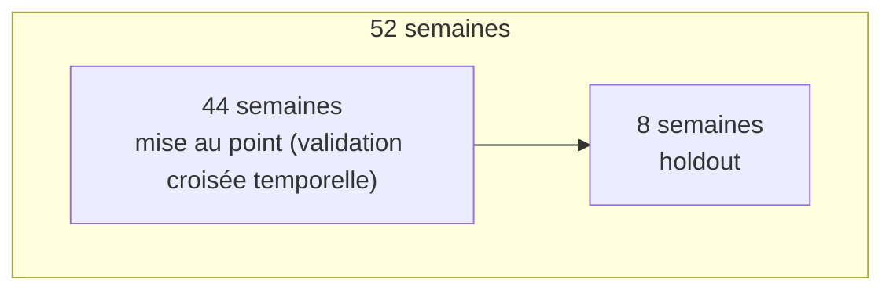
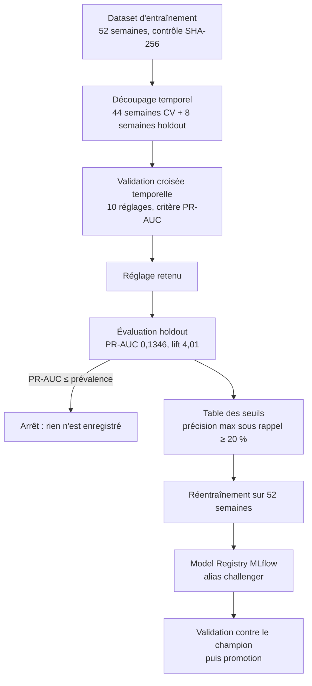

# Construction de l'algorithme

Ce document décrit comment le modèle d'Orion est construit : le choix de l'algorithme, le découpage des données, la mise au point, l'évaluation et le choix du seuil de décision. Le code correspondant est `scripts/entrainer_modele.py` (dépôt `Orion`). Les définitions du dataset (cible, features, postulats) sont dans [dataset_entraienement_et_presupposes.md](dataset_entraienement_et_presupposes.md), l'utilisation du modèle en production dans [fonctionnement_algorithme_production.md](fonctionnement_algorithme_production.md).

## 1. Le problème posé

Chaque semaine, le category manager décide d'acheter ou non chaque article du catalogue. Orion lui propose une liste d'articles à examiner.

- **Unité statistique** : une ligne = un article × une semaine cible (identifiée par sa *date de coupure*, le lundi 00:00 de la semaine).
- **Cible** : `achat` = 1 si l'article fait l'objet d'au moins une décision d'achat dans la semaine, 0 sinon.
- **Type de problème** : classification binaire, avec une cible **rare** : environ 3,4 % de lignes positives (prévalence de 0,0335 sur le holdout).
- **Sortie** : pour chaque article, une probabilité d'achat, puis une alerte « à examiner » si cette probabilité dépasse un seuil.

La rareté de la cible conditionne tous les choix qui suivent : métrique, pondération des classes, seuil.

## 2. Les variables d'entrée

Dix variables, toutes calculées en SQL (dbt) à partir de faits antérieurs à la coupure. Elles sont définies une seule fois et servent à l'identique à l'entraînement et au scoring hebdomadaire.

| Variable | Idée métier |
|---|---|
| `ventes_semaine_w1`, `ventes_semaine_w2` | Les ventes récentes annoncent un besoin urgent |
| `ventes_moyennes_hebdo_52s` | Niveau de ventes habituel de l'article |
| `time_since_last_buy`, `prev_achat_qte` | Ancienneté et taille du dernier achat |
| `stock_a_date`, `achat_en_cours_a_date`, `couverture_stock_semaines` | Le stock, ce qui est déjà commandé, et ce que cela représente en semaines de ventes |
| `promotion_4_mois` | Une promotion à venir génère des ventes supplémentaires (binaire) |
| `delai_acheminement_jours` | Délai à anticiper pour rester en flux tendus |

L'ordre de ces colonnes est figé : il est enregistré avec le modèle (`feature_cols`) et appliqué tel quel par l'API.

## 3. Choix de l'algorithme : une régression logistique

Le modèle est une **régression logistique** : il calcule une somme pondérée des dix variables, puis la transforme en probabilité entre 0 et 1.

```
probabilité = 1 / (1 + exp(-(b + w1·x1 + w2·x2 + … + w10·x10)))
```

Pourquoi ce choix :

- **Lisible** : chaque variable a un coefficient dont le signe et le poids s'expliquent à un acheteur (« plus la couverture de stock est faible, plus la probabilité monte »).
- **Robuste** avec peu de signal : la cible est rare et bruitée (postulat 13 : des données manquent encore). Un modèle plus flexible aurait surtout appris le bruit.
- **Simple à exploiter** : un seul objet `Pipeline` scikit-learn (préparation + modèle), versionné dans MLflow et appliqué tel quel par l'API.

Deux réglages fixés d'avance :

- `class_weight="balanced"` : chaque classe est pondérée par l'inverse de sa fréquence, donc une ligne positive pèse environ 30 fois plus qu'une ligne négative. Sans cela, le modèle trouverait son compte à répondre « pas d'achat » partout.
- `random_state=42`, `max_iter=5000` : reproductibilité et convergence.

> **Conséquence à retenir** : à cause de la pondération, la probabilité produite n'est **pas calibrée**. Un score de 0,70 ne veut pas dire « 70 % de chances d'achat » ; c'est un **score de classement**. Ce que vaut un score se lit dans la table des seuils (§7), par la précision observée.

## 4. Préparation des variables

La préparation est la première étape du `Pipeline`. Elle est apprise sur les données d'entraînement uniquement, puis réappliquée à l'identique au scoring. Deux variantes sont comparées :

- **`standard`** : standardisation (centrage, réduction) de chaque variable numérique ;
- **`arcsinh_standard`** : transformation `arcsinh` puis standardisation. `arcsinh(x) ≈ signe(x)·log(2|x|)` écrase les queues très longues (quelques articles très vendus ou très stockés) tout en acceptant les zéros et les valeurs négatives (retours clients).

`promotion_4_mois`, binaire, passe telle quelle.

## 5. Découpage des données : temporel, jamais aléatoire

Le dataset couvre **52 coupures hebdomadaires** (du 16/06/2025 au 08/06/2026, voir le dossier de constitution du dataset).

Un tirage aléatoire serait faux ici : les mêmes articles reviennent chaque semaine, donc des lignes d'une même semaine ou d'articles voisins dans le temps se retrouveraient des deux côtés et le score serait artificiellement bon. On découpe donc dans le temps : on apprend toujours sur le passé, on évalue toujours sur ce qui suit.



- **Holdout** : les 8 dernières semaines, mises de côté et jamais utilisées pour régler le modèle. Elles ne servent qu'à une évaluation honnête et au choix du seuil.
- **Validation croisée temporelle** sur les 44 premières semaines, à **fenêtre croissante** :

| Pli | Apprentissage | Validation |
|---|---|---|
| 1 | semaines 1-20 | semaines 21-24 |
| 2 | semaines 1-24 | semaines 25-28 |
| 3 | semaines 1-28 | semaines 29-32 |
| 4 | semaines 1-32 | semaines 33-36 |
| 5 | semaines 1-36 | semaines 37-40 |

Les paramètres sont `MIN_SEMAINES_APPRENTISSAGE = 20` et `NB_PLIS_CV = 5`. Un pli dont la validation ou l'apprentissage ne contient qu'une classe est ignoré et compté, car la PR-AUC n'y est pas définie (d'où `plis = 4` dans la sortie ci-dessous : un des cinq plis a été écarté).

## 6. Mise au point : validation croisée sur la PR-AUC

### La métrique : PR-AUC (average precision)

Avec 3,4 % de positifs, l'exactitude (accuracy) est inutilisable : répondre « jamais d'achat » donne 96,6 %. On utilise l'**aire sous la courbe précision-rappel** (PR-AUC). Un modèle au hasard obtient une PR-AUC égale à la prévalence. On lit donc le résultat en **lift** = PR-AUC / prévalence (1 = hasard).

Cela rejoint le postulat 12 : la précision prime (une fausse recommandation coûte plus qu'un achat manqué), le rappel reste surveillé.

### La grille testée

2 préparations × 5 valeurs de régularisation C (0,001 ; 0,01 ; 0,1 ; 1 ; 10) = **10 réglages**. C contrôle l'intensité de la régularisation : un C petit contraint fortement les coefficients, un C grand les laisse libres. Chaque réglage est entraîné sur chaque pli, puis on moyenne la PR-AUC de validation. Chaque réglage est tracé dans MLflow (un run enfant par réglage).

### Résultat

| Préparation | C | PR-AUC (CV) | Écart-type | Lift (CV) | Plis |
|---|---|---|---|---|---|
| standard | 0,1 | 0,0681 | 0,0412 | 2,39 | 4 |
| standard | 1 | 0,0681 | 0,0411 | 2,39 | 4 |
| standard | 10 | 0,0681 | 0,0411 | 2,39 | 4 |
| standard | 0,01 | 0,0679 | 0,0409 | 2,38 | 4 |
| standard | 0,001 | 0,0669 | 0,0393 | 2,37 | 4 |
| arcsinh_standard | 0,01 | 0,0634 | 0,0400 | 2,36 | 4 |
| arcsinh_standard | 0,001 | 0,0633 | 0,0404 | 2,34 | 4 |
| arcsinh_standard | 1 | 0,0633 | 0,0399 | 2,35 | 4 |
| arcsinh_standard | 0,1 | 0,0633 | 0,0399 | 2,35 | 4 |
| arcsinh_standard | 10 | 0,0633 | 0,0399 | 2,35 | 4 |

**Lecture :**

- Tous les réglages sont **au-dessus du hasard** (lift d'environ 2,4).
- Le **réglage retenu** est celui de tête : `standard`, C = 0,1.
- La valeur de C change très peu le résultat (de 0,0669 à 0,0681) : le modèle est stable, la régularisation n'est pas le levier principal.
- La standardisation seule fait légèrement mieux que `arcsinh` (0,068 contre 0,063). L'écart reste faible devant l'écart-type entre plis (environ 0,04), donc à ne pas sur-interpréter.
- L'**écart-type élevé entre plis** (0,04 pour une moyenne de 0,07) montre que la performance varie beaucoup d'une période à l'autre. Cohérent avec des décisions d'achat très irrégulières d'une semaine à l'autre (voir les limites du dataset).

## 7. Évaluation sur le holdout

On réentraîne avec le réglage retenu sur les **44 semaines de validation croisée seulement**, puis on évalue sur les 8 semaines du holdout, jamais vues.

| Indicateur | Valeur |
|---|---|
| Prévalence (taux d'achat au hasard) | 0,0335 |
| PR-AUC | **0,1346** |
| Lift | **4,01** (le hasard vaut 1) |

Le modèle classe donc les vrais achats environ **quatre fois mieux que le hasard**. Le score du holdout dépasse celui de la validation croisée (lift 2,4) : l'écart reste dans la fourchette de variation observée entre plis, et ce holdout couvre la période la plus récente. Il ne prouve pas à lui seul que le modèle s'améliore.

**Garde-fou** : si la PR-AUC du holdout n'est pas supérieure à la prévalence, le script s'arrête, rien n'est enregistré et le run MLflow est marqué `FAILED`.

## 8. Choix du seuil de décision

Le modèle sort un score ; il faut un **seuil** au-delà duquel on lève une alerte. Choisir le seuil, c'est arbitrer entre :

- **précision** : parmi les alertes, quelle part est un vrai achat ;
- **rappel** : parmi les vrais achats, quelle part est détectée ;
- **charge de travail** : nombre d'alertes par semaine que l'acheteur doit examiner.

### Table des seuils (holdout, 8 semaines)

| Seuil | Précision | Rappel | Alertes / semaine |
|---|---|---|---|
| 0,051 | 0,034 | 1,000 | 1167,5 |
| 0,100 | 0,037 | 0,978 | 1048,6 |
| 0,200 | 0,040 | 0,952 | 934,6 |
| 0,300 | 0,046 | 0,879 | 754,6 |
| 0,400 | 0,056 | 0,796 | 555,3 |
| 0,500 | 0,068 | 0,739 | 428,1 |
| 0,600 | 0,089 | 0,659 | 290,0 |
| 0,650 | 0,119 | 0,510 | 168,3 |
| **0,708** | **0,173** | **0,217** | **49,1** |
| 0,751 | 0,207 | 0,080 | 15,1 |
| 0,801 | 0,356 | 0,051 | 5,6 |
| 0,852 | 0,450 | 0,029 | 2,5 |
| 0,903 | 0,500 | 0,013 | 1,0 |
| 0,950 | 0,667 | 0,006 | 0,4 |

(Extrait de la grille complète : la sortie intégrale figure dans le run MLflow, artefact `table_seuils.csv`.)

### La règle retenue

> **Précision maximale sous la contrainte d'un rappel d'au moins 20 %** (`--rappel-min 0.20`), calculée sur le holdout.

C'est la traduction directe du postulat 12. À précision égale, on prend le seuil le plus bas, qui garde le plus de rappel. Si aucun seuil n'atteint le rappel plancher, le script s'arrête.

**Seuil proposé : 0,708** : précision 0,173, rappel 0,217, **49 alertes par semaine**.

### Ce que cela change pour l'acheteur

- Sans modèle, parcourir les quelque 1 200 articles notés chaque semaine pour retrouver les achats de la semaine donne 3,4 % de bonnes pistes.
- Avec le seuil à 0,708, la liste tient en **une cinquantaine d'articles**, dont **17 %** sont de vraies décisions d'achat, soit **5 fois plus** que le hasard, au prix de **78 % d'achats non signalés**.
- Les deux extrêmes de la table montrent le compromis : un seuil bas détecte tout mais noie l'acheteur (plus de 1 000 alertes), un seuil haut est très précis mais ne signale presque rien.

Le seuil proposé n'est qu'une **proposition** : la table est présentée pour validation, et le seuil peut être imposé (`--seuil 0.62`) avant l'enregistrement. Il est ensuite rangé dans les métadonnées du modèle (`decision_threshold`) et reste **immuable avec la version**.

## 9. Réentraînement final et enregistrement

Une fois le réglage et le seuil validés (`--enregistrer`) :

1. le modèle est **réentraîné sur les 52 semaines** (holdout compris) avec le réglage retenu, pour exploiter toute l'information disponible ;
2. le `Pipeline` complet (préparation + régression logistique) est enregistré dans le **Model Registry MLflow** (`orion_achat_predictor`) avec l'alias **`challenger`** ;
3. sont rangés avec lui : le seuil, la liste ordonnée des variables, la version du dataset, ainsi que les tags de traçabilité (dernière semaine d'entraînement, auteur, description, empreinte du script).

Le seuil étant choisi sur un holdout puis appliqué à un modèle réentraîné avec ces 8 semaines en plus, les métriques annoncées (précision 0,173, rappel 0,217) sont des estimations : elles seront re-mesurées en production sur les vrais batchs (voir le document de fonctionnement en production).

Le modèle n'est **pas** mis en production par l'entraînement. L'alias `champion` (servi par l'API) n'est attribué qu'après la validation décrite dans [soumettre_un_modele.md](soumettre_un_modele.md).

### Traçabilité

Un run MLflow (expérience `orion_achat`) garde pour chaque exécution : la version et l'empreinte SHA-256 du dataset, vérifiée contre son manifest avant tout calcul, l'empreinte du script, la version de scikit-learn, les réglages, les métriques du holdout et la table des seuils. On peut ainsi retrouver pour n'importe quel modèle les données et le code qui l'ont produit.

## 10. Résumé des étapes



## 11. Limites assumées

- **Signal modeste** : un lift de 4 est utile pour prioriser, pas pour automatiser. Le modèle aide à décider, il ne décide pas.
- **Variance** : la performance varie fortement d'une période à l'autre (écart-type entre plis proche de la moyenne) ; huit semaines de holdout restent un échantillon court.
- **Promotion estimée en production** : l'entraînement voit des promotions réelles, le scoring hebdomadaire des promotions estimées (postulat 8 bis), ce qui dégrade la fiabilité des prédictions en production.
- **Données manquantes** (postulat 13) : remplissage du dépôt, groupage des commandes et contexte géopolitique ne sont pas encore captés.
- **Probabilités non calibrées** : à lire comme un classement, pas comme une chance d'achat.
