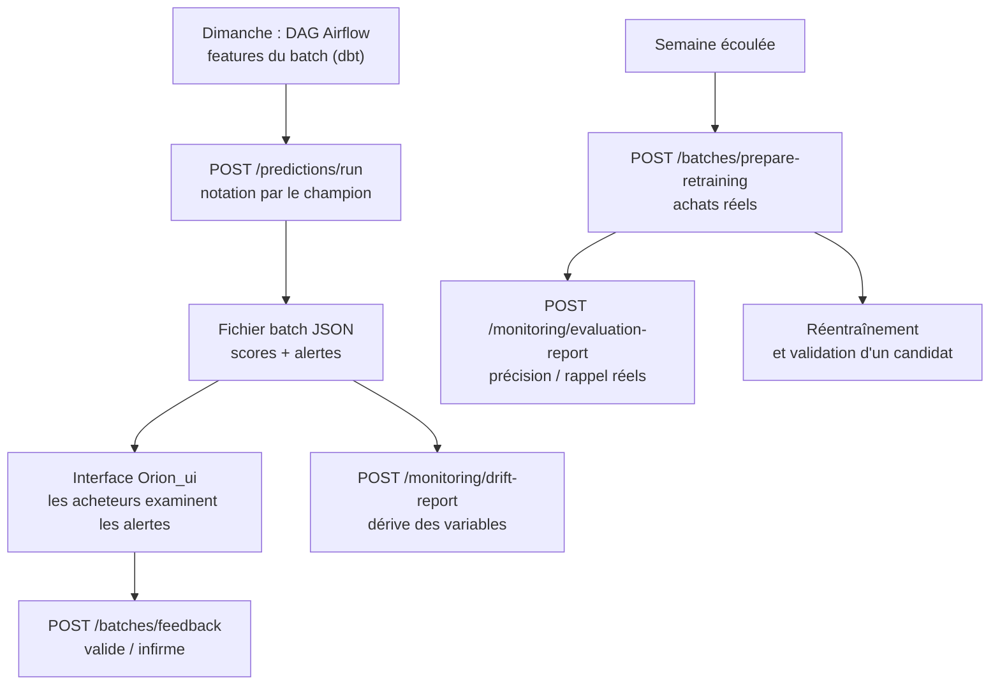

# Fonctionnement de l'algorithme en production

Ce document décrit ce qui se passe chaque semaine une fois le modèle en service : calcul des features, notation du batch, retour des acheteurs, mesure de la performance réelle, surveillance de la dérive, et remplacement du modèle. La construction du modèle est décrite dans [construction_algorithme.md](construction_algorithme.md), les définitions du dataset dans [dataset_entraienement_et_presupposes.md](dataset_entraienement_et_presupposes.md).

Le code est dans le dépôt `Orion` (API FastAPI) et `Orion_ui` (interface). Le détail de chaque route est dans le `TESTS.md` d'Orion.

## 1. Vue d'ensemble : le cycle hebdomadaire

Les appels `/predictions`, `/monitoring/*` et `/batches/prepare-retraining` sont déclenchés par les DAG Airflow ; `/batches/*/predictions` et `/batches/feedback` par l'interface utilisateur.

## 2. Étape 1 : calcul des features du batch

Le batch de la semaine cible est constitué **le dimanche précédent**, avec la coupure C = lundi 00:00 de la semaine à prédire. Les features sont calculées par les **mêmes modèles dbt** que le dataset d'entraînement (table `gold__orion.ml_features_batch`) : un batch a donc exactement le schéma et les définitions du dataset d'entraînement, et peut lui être concaténé pour un réentraînement. C'est la garantie qu'on n'applique pas au modèle des variables calculées autrement que celles qu'il a apprises.

Ce que le batch ne peut pas reproduire à l'identique de l'entraînement :

- **la promotion** : elle est estimée (tirage au taux hebdomadaire moyen figé) faute d'être connue au moment du calcul (postulat 8 bis) ;
- **les décisions d'achat en cours** : une demande encore ouverte le dimanche est comptée comme décision (postulat 4 bis).

**Fraîcheur** : si la copie de l'ERP d'une société date d'avant le vendredi de la semaine précédente, le batch est produit mais marqué « données incomplètes » : noté et affiché, mais exclu des réentraînements.

## 3. Étape 2 : notation par le modèle champion

`POST /predictions/run` lit la table de features et note chaque ligne :

1. **Résolution du modèle** : l'API demande au Model Registry MLflow la version portant l'alias `champion`. L'alias est résolu à chaque appel et le modèle est conservé en mémoire tant que l'alias pointe sur la même version. Une promotion prend donc effet à l'appel suivant, sans redéploiement. Si le Registry est injoignable, le modèle déjà en mémoire continue d'être servi (avec un avertissement et une métrique dédiée) ; sans modèle en mémoire, l'API répond 503.
2. **Contrôles d'entrée** : les colonnes attendues (`feature_cols`, lues dans les métadonnées du modèle) doivent toutes exister (sinon 422), et aucune ne doit contenir de valeur manquante (sinon 422 : la table doit être nettoyée en amont, les modèles dbt n'en produisent pas).
3. **Calcul du score** : le `Pipeline` enregistré applique la préparation puis la régression logistique, `predict_proba` renvoie une probabilité pour chaque ligne.
4. **Décision** : `prediction = 1` si `probabilité >= seuil`, avec le seuil lu dans les métadonnées de **la version servie** (0,708 pour le modèle de référence).

La réponse (et le fichier batch) contient pour chaque article : `prediction`, `prediction_proba`, les features, ainsi que `model_version`, `version_dataset` et `decision_threshold`. Tout batch indique donc quel modèle l'a noté, avec quel seuil.

Avec le modèle de référence, on attend environ **50 alertes par semaine** sur environ 1 200 articles notés chaque semaine.

## 4. Étape 3 : restitution aux acheteurs et retour d'information

`GET /batches/{fichier}/predictions?email=…` renvoie les lignes du batch, enrichies des informations de l'article (référence, libellé, société). Deux règles :

- **Périmètre** : un utilisateur ne voit que les sociétés autorisées dans `data/users.json` (par exemple `sod`, `fri`, ou toutes). Le même contrôle s'applique à l'enregistrement du feedback.
- **Traçabilité de l'affichage** : les lignes renvoyées sont marquées `prediction_affichee` avec un horodatage dans le fichier batch. On sait ainsi ce que l'acheteur a effectivement eu sous les yeux.

`POST /batches/feedback` enregistre la décision de l'acheteur pour chaque article (`decision_utilisateur` : valide ou infirme, avec l'email et la date). Le statut du batch passe à `validation_utilisateur_en_cours`, puis `validation_utilisateur_terminee` quand toutes les lignes ont été affichées.

Les fichiers sont écrits de façon sûre : verrou exclusif non bloquant (423 invitant à réessayer en cas d'accès concurrent), écriture dans un fichier temporaire puis remplacement atomique.

> Le feedback est conservé mais **n'alimente pas encore l'entraînement** : la vérité terrain d'un batch est l'achat réellement constaté (étape suivante), non l'avis de l'acheteur.

## 5. Étape 4 : vérité terrain et mesure de la performance réelle

Une fois la semaine prédite écoulée :

1. **`POST /batches/prepare-retraining`** note le batch avec les achats réels. Elle lit `gold__orion.ml_notation_batch`, calculée par dbt avec la **même définition de la cible** que l'entraînement, et ajoute `operation_achat` (0 ou 1) à chaque ligne. La semaine notée est celle de la coupure du batch, jamais la date d'appel : un batch noté en retard reste noté sur la semaine qu'il prédisait. Si la table de notation ne porte pas sur la bonne coupure, l'API répond 409 plutôt que de noter à tort.
2. **`POST /monitoring/evaluation-report`** compare `prediction` et `operation_achat` sur le dernier batch et calcule : précision, rappel, F1, exactitude, matrice de confusion et PR-AUC (non définie si la semaine ne contient qu'une classe, ce qui est signalé). Les métriques sont sauvegardées en JSON, accompagnées d'un rapport HTML Evidently, et historisées (page Administration > Performance du modèle).

C'est la mesure qui compte vraiment : elle permet de comparer, semaine après semaine, la **précision et le rappel réels** aux valeurs attendues du holdout (précision 0,173, rappel 0,217 au seuil de 0,708). C'est aussi l'indicateur de suivi du projet.

## 6. Étape 5 : surveillance de la dérive

`POST /monitoring/drift-report` compare les features du batch courant à celles d'une table de référence (le dataset d'entraînement) avec le preset de dérive d'Evidently : test statistique par variable, puis indicateur de dérive globale. La réponse donne `dataset_drift`, la part de variables en dérive et leur liste ; un rapport HTML est produit.

Si une variable en entrée change de distribution (nouvelle saisonnalité, changement de politique de stock, problème de qualité d'une source), la performance peut se dégrader **avant** qu'on puisse la mesurer sur les achats réels. La dérive sert donc d'alerte précoce.

Elle déclenche l'alerte Grafana `OrionDriftDetected`. Parmi les autres alertes d'exploitation : `OrionBatchMissing` (pas de batch dans les temps), `OrionModelRegistryUnreachable`, `OrionHighErrorRate`, `OrionApiDown`.

## 7. Étape 6 : faire évoluer le modèle

Le modèle est réentraîné quand les batchs notés ont fait croître les données, ou quand la dérive ou la performance le justifie. Les batchs notés, au même schéma que le dataset d'entraînement, peuvent lui être concaténés (hors batchs « données incomplètes » : on garde au moins 45 semaines valides).

Un nouveau modèle ne remplace jamais le champion automatiquement :

1. l'entraînement l'enregistre avec l'alias `challenger` ;
2. **`POST /model/validation`** le compare au champion sur des batchs notés **que ni l'un ni l'autre n'a vus à l'entraînement** (coupure postérieure à la dernière semaine d'entraînement des deux modèles), sur les mêmes lignes, chacun à son propre seuil ;
3. le verdict est « conforme » si toutes les conditions sont remplies :

| Condition | Règle |
|---|---|
| Contrat du modèle | Se charge avec scikit-learn, expose `predict_proba`, même version de scikit-learn que l'API |
| Métadonnées | `feature_cols`, `decision_threshold` (dans ]0 ; 1[), `version_dataset` présents et valides |
| Tags | `derniere_semaine_entrainement`, `auteur`, `description`, `code_source` renseignés |
| Variables | Toutes les `feature_cols` existent en production et dans les batchs retenus, sans valeur manquante |
| Semaines non vues | Le nombre de batchs demandés (1 à 4) existe après la dernière semaine d'entraînement des deux modèles |
| PR-AUC | Strictement supérieure à celle du champion : un nouveau modèle doit **prédire mieux**, pas aussi bien |
| Précision au seuil | Supérieure ou égale à celle du champion |
| Rappel au seuil | Supérieur ou égal à 0,20 |

4. si le verdict est conforme, l'alias `champion` est déplacé **à la main dans l'interface MLflow** : la décision de promotion reste humaine. Le prochain appel de l'API sert le nouveau modèle ; le retour arrière consiste à remettre l'alias sur l'ancienne version.

La procédure complète pour un data scientist est dans [soumettre_un_modele.md](soumettre_un_modele.md).

## 8. Observabilité

- **Logs JSON** sur la sortie standard, collectés par Alloy puis Loki : une ligne par requête (route, statut, durée, identifiant de requête) et des événements métier (`model_loaded`, `prediction_run`, `drift_report`, `evaluation_report`, `model_validation`). Jamais de prédiction ligne à ligne ni de donnée client.
- **Métriques Prometheus** (`/metrics`) : requêtes et latences, version et seuil du modèle servi, nombre de lignes et d'alertes par batch, distribution des scores, durée de notation, dérive et performance du dernier batch noté.
- **Tableau de bord Grafana** « Orion : API et modèle ».

## 9. Pourquoi ce fonctionnement

| Choix | Raison |
|---|---|
| Une seule définition des features et de la cible, en SQL | Pas de décalage entre ce que le modèle a appris et ce qu'on lui demande en production |
| Seuil enregistré avec la version du modèle | Un modèle et son seuil forment un tout, impossible de les désynchroniser |
| Alias `champion` résolu à chaque appel | Promotion et retour arrière immédiats, sans redéploiement |
| Notation sur la coupure du batch | Une performance mesurée sur la bonne semaine, même avec du retard |
| Promotion validée sur des semaines inédites, décidée par un humain | Éviter qu'un modèle ne soit promu parce qu'il a « vu » ses propres données de test |
| Évaluation et dérive à chaque batch | Détecter une dégradation sans attendre un réentraînement |

## 10. Limites et points de vigilance

- **Performance réelle inconnue au démarrage** : les chiffres du holdout sont des estimations. Les premiers rapports d'évaluation hebdomadaires diront si elles tiennent.
- **Promotion estimée** : écart d'information entre entraînement et production (postulat 8 bis), une cause probable de dégradation.
- **Semaines très irrégulières** : certaines semaines n'ont aucun achat (PR-AUC non définie), d'autres plus de 50 ; la précision d'une seule semaine est donc très variable. La tendance se lit sur plusieurs semaines.
- **Demandes ouvertes comptées comme achats** (postulat 4 bis) : certaines seront requalifiées en anomalies, ce qui bruite légèrement la vérité terrain.
- **Un seul worker applicatif** : les métriques sont par processus ; avec plusieurs workers, il faudrait le mode multiprocess de `prometheus_client`.
