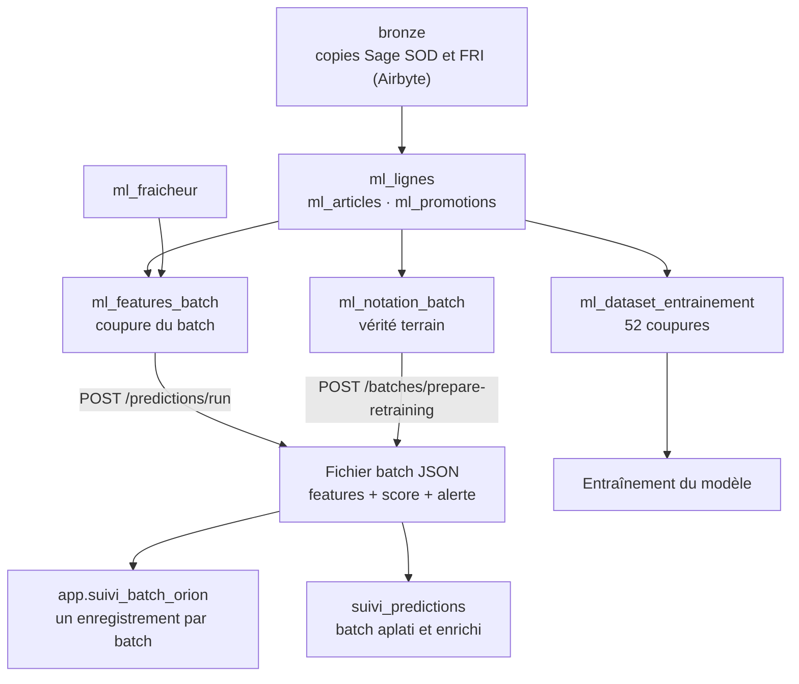

# Schéma du dataset d'entraînement et d'un batch dans Astro

Ce document décrit les tables d'Orion dans le datawarehouse Astro (Postgres) : le dataset d'entraînement, le batch hebdomadaire, et les tables qui les relient. Le schéma, les volumes et les statistiques ont été relevés directement dans Astro le 05/11/2026, en lecture seule. Les définitions métier sont dans [dataset_entraienement_et_presupposes.md](dataset_entraienement_et_presupposes.md).

## 1. Vue d'ensemble

Tout est construit en dbt à partir des mêmes macros : les features du dataset d'entraînement et celles d'un batch ont donc **le même schéma et les mêmes définitions**.

| Schéma | Table | Rôle | Lignes |
|---|---|---|---|
| `gold__orion` | `ml_dataset_entrainement` | Dataset d'entraînement : features + cible | 60 572 |
| `gold__orion` | `ml_features_batch` | Features du batch de la semaine à prédire | 1 239 |
| `gold__orion` | `ml_notation_batch` | Cible réelle de la semaine écoulée (notation) | 12 297 |
| `gold__orion` | `ml_coupures_entrainement` | Les 52 coupures du dataset | 52 |
| `gold__orion` | `ml_coupure_batch` | Coupure du batch courant | 1 |
| `gold__orion` | `ml_fraicheur` | Fraîcheur de la copie Sage, par société | 2 |
| `gold__orion` | `ml_articles`, `ml_lignes`, `ml_promotions` | Tables intermédiaires (articles, lignes de documents, promotions) | |
| `app` | `suivi_batch_orion` | Suivi des batchs (statut, fichier, fraîcheur) | 10 |
| `gold__orion` | `suivi_predictions` | Prédictions des batchs, enrichies, avec la décision utilisateur et le résultat réel | 3 716 |

## 2. Dataset d'entraînement : `gold__orion.ml_dataset_entrainement`

**Grain** : une ligne = un article d'une société × une coupure hebdomadaire. La clé `(societe, reference_article, date_coupure)` est unique (60 572 lignes, 60 572 clés distinctes).

### Colonnes

| # | Colonne | Type | Rôle | Description |
|---|---|---|---|---|
| 1 | `societe` | text | clé | `sod` ou `fri` |
| 2 | `reference_article` | text | clé | Référence de l'article dans l'ERP |
| 3 | `identifiant_article_hash` | text | clé | Identifiant d'article pseudonymisé, partagé avec le datawarehouse |
| 4 | `date_coupure` | date | clé | Lundi 00:00 de la semaine cible ; les features n'utilisent que des faits antérieurs |
| 5 | `annee_iso` | integer | repère | Année ISO |
| 6 | `semaine_iso` | integer | repère | Numéro de semaine ISO |
| 7 | `ventes_semaine_w1` | numeric | **feature** | Ventes nettes du dépôt 1, semaine w-1 |
| 8 | `ventes_semaine_w2` | numeric | **feature** | Ventes nettes du dépôt 1, semaine w-2 |
| 9 | `ventes_moyennes_hebdo_52s` | numeric | **feature** | Ventes nettes des 52 semaines précédentes / 52 |
| 10 | `time_since_last_buy` | integer | **feature** | Jours depuis la dernière décision d'achat (730 = aucune sur 2 ans) |
| 11 | `prev_achat_qte` | numeric | **feature** | Quantité de la dernière décision d'achat |
| 12 | `stock_a_date` | numeric | **feature** | Stock du dépôt 1 à la coupure |
| 13 | `achat_en_cours_a_date` | numeric | **feature** | Quantités décidées sur 52 semaines, pas encore réceptionnées |
| 14 | `couverture_stock_semaines` | numeric | **feature** | (stock + en cours) / ventes hebdomadaires moyennes, borné à 104 |
| 15 | `promotion_4_mois` | integer | **feature** | 1 si l'article est en promotion dans les 4 mois suivants (réelle à l'entraînement) |
| 16 | `delai_acheminement_jours` | numeric | **feature** | Délai moyen observé entre décision et réception sur 2 ans |
| 17 | `achat` | integer | **cible** | 1 si au moins une décision d'achat dans la semaine cible |
| 18 | `version_dataset` | text | traçabilité | Version du dataset (`orion_ds_2026W24_copie20261014`) |
| 19 | `date_copie` | date | traçabilité | Date de la copie de l'ERP utilisée (2026-10-14) |
| 20 | `dbt_invocation_id` | text | traçabilité | Exécution dbt qui a produit la table |

Les 10 features, dans cet ordre, sont celles de `FEATURE_COLS` dans `scripts/entrainer_modele.py` ; la cible est `achat`.

### Volumes

| Mesure | Valeur |
|---|---|
| Lignes | 60 572 |
| Coupures | 52, du 2025-06-16 (2025-W25) au 2026-06-08 (2026-W24) |
| Articles distincts | 1 342 |
| Lignes par coupure | environ 1 165 en moyenne |
| Décisions d'achat (`achat = 1`) | 1 324, soit une prévalence de **2,19 %** |

| Société | Lignes | Achats | Prévalence |
|---|---|---|---|
| `sod` | 46 562 | 919 | 1,97 % |
| `fri` | 14 010 | 405 | 2,89 % |

> La prévalence sur l'ensemble des 52 semaines (2,19 %) est inférieure à celle des 8 semaines du holdout (3,35 %, voir [construction_algorithme.md](construction_algorithme.md)) : les décisions d'achat sont plus nombreuses en fin de période. C'est aussi un rappel que la prévalence varie nettement dans le temps.

### Distribution des variables

| Variable | Médiane | 95e percentile | Max | % de zéros |
|---|---|---|---|---|
| `ventes_semaine_w1` | 0 | 264 | 21 400 | 60,5 % |
| `ventes_semaine_w2` | 0 | 264 | 21 400 | 60,6 % |
| `ventes_moyennes_hebdo_52s` | 10,6 | 222 | 9 759 | 9,8 % |
| `time_since_last_buy` | 220 | 730 | 730 | 0 % |
| `prev_achat_qte` | 300 | 4 760 | 386 400 | 19,6 % |
| `stock_a_date` | 168 | 4 999 | 347 320 | 25,2 % |
| `achat_en_cours_a_date` | 0 | 3 360 | 386 400 | 71,2 % |
| `couverture_stock_semaines` | 33,3 | 104 (borne) | 104 | 13,7 % |
| `delai_acheminement_jours` | 89,1 | 122 | 242 | 0 % |
| `promotion_4_mois` | | | | 14,3 % de 1 |

Ces distributions expliquent les choix de préparation du modèle : beaucoup de zéros (ventes, achats en cours), des queues très longues (quelques articles à plusieurs milliers d'unités, d'où la variante `arcsinh` testée) et des valeurs négatives pour les ventes (retours clients, jusqu'à -1 220 sur une semaine).

## 3. Batch hebdomadaire

Un batch se retrouve sous quatre formes complémentaires.

### 3.1 Les features : `gold__orion.ml_features_batch`

**Grain** : un article d'une société × la coupure du batch. Même schéma que le dataset d'entraînement pour les colonnes 1 à 16, sans la cible ni les colonnes de traçabilité dbt, avec deux colonnes de fraîcheur.

| Colonnes | Description |
|---|---|
| 1 à 16 | Identiques à `ml_dataset_entrainement` (clés, repères, 10 features) |
| 17 `date_fraicheur` | Date jusqu'à laquelle la copie de l'ERP est à jour |
| 18 `donnees_completes` | `false` si la copie de l'ERP est antérieure au vendredi de la semaine w-1 : batch noté, mais exclu des réentraînements |

État actuel : 1 239 lignes pour une seule coupure (2026-11-02, semaine 2026-W45), dont 981 `sod` et 258 `fri`.

**Écarts avec l'entraînement :**

- `promotion_4_mois` est **estimée** (tirage au taux hebdomadaire moyen figé), alors qu'elle est réelle à l'entraînement (postulat 8 bis). Les taux sont proches : 14,8 % de 1 dans le batch, 14,3 % à l'entraînement.
- Les autres variables ont des distributions voisines (médiane des ventes à 0 dans les deux cas, délai médian de 91 jours contre 89 jours, couverture médiane de 48 semaines contre 33).

### 3.2 La vérité terrain : `gold__orion.ml_notation_batch`

| Colonne | Type | Description |
|---|---|---|
| `date_coupure` | date | Coupure de la semaine notée |
| `societe`, `reference_article`, `identifiant_article_hash` | text | Article |
| `achat` | integer | 1 si l'article a eu une décision d'achat pendant la semaine |

Calculée avec la **même définition de la cible** que le dataset d'entraînement (macro dbt `orion_ml_cible`). Elle contient une ligne par article du catalogue (12 297 lignes pour la coupure 2026-10-26, dont 8 achats) et non uniquement par article noté ; l'API la rapproche des lignes du batch par `identifiant_article_hash`.

### 3.3 Le suivi : `app.suivi_batch_orion`

Une ligne par batch.

| Colonne | Type | Description |
|---|---|---|
| `id` | integer | Identifiant technique |
| `batch_id` | varchar | Numéro du batch (`00001`, `00002`…) |
| `annee`, `semaine` | integer | Année et semaine ISO prédites |
| `statut` | varchar | Étape du cycle de vie (voir ci-dessous) |
| `uri_dataset_batch` | varchar | Chemin du fichier JSON du batch |
| `uri_rapport_html` | varchar | Chemin du rapport de dérive Evidently |
| `last` | boolean | Vrai pour le batch le plus récent |
| `date_maj` | timestamp | Dernière mise à jour |
| `date_coupure` | date | Coupure du batch |
| `date_fraicheur` | date | Fraîcheur de la copie Sage lors du calcul |
| `donnees_completes` | boolean | Voir 3.1 |

Statuts observés ou décrits dans le code : `drift_analysis_ok`, `batch finalise`, `validation_utilisateur_en_cours`, `validation_utilisateur_terminee`, `operations_reelles_enregistrees`.

Trois batchs existent à ce jour, tous marqués `donnees_completes = false` :

| Batch | Semaine | Statut | Fraîcheur ERP |
|---|---|---|---|
| 00001 | 2026-W43 | batch finalise | 2026-10-14 |
| 00002 | 2026-W44 | batch finalise | 2026-10-21 |
| 00003 | 2026-W45 | drift_analysis_ok (dernier) | 2026-10-28 |

### 3.4 Le fichier batch JSON

Le fichier est écrit par Airflow et complété par l'API (voir `src/services/batch_service.py`).

| Niveau | Contenu |
|---|---|
| Entête | `batch_id`, `date_coupure`, `statut_batch`, `model_version`, `periode_operations_achat` (début et fin, ajoutées à la notation) |
| `predictions.predictions[]` | Une entrée par article |

Chaque entrée contient :

| Groupe | Champs |
|---|---|
| Identification | `societe`, `reference_article`, `identifiant_article_hash` |
| Features | Les 10 features du modèle |
| Modèle | `prediction` (0/1), `prediction_proba` (score) |
| Affichage | `prediction_affichee`, `date_affichage` |
| Retour utilisateur | `decision_utilisateur`, `email_decision_utilisateur`, `date_decision_utilisateur` |
| Vérité terrain | `operation_achat` (0/1), ajoutée par `/batches/prepare-retraining` |

### 3.5 La vue analytique : `gold__orion.suivi_predictions`

Les batchs aplatis en une table : 3 716 lignes, soit les trois batchs existants (environ 1 240 lignes chacun). Chaque ligne rassemble le score, la décision de l'utilisateur et le résultat réel.

| Groupe | Colonnes |
|---|---|
| Batch | `suivi_prediction_id`, `batch_id`, `fichier_batch`, `date_semaine_cible`, `semaine_cible`, `annee_iso`, `semaine_iso`, `date_batch`, `date_coupure`, `statut_batch`, `est_dernier_batch_semaine`, `donnees_completes`, `date_fraicheur` |
| Modèle | `model_version`, `version_dataset`, `decision_threshold` |
| Article | `societe`, `reference_article`, `identifiant_article_hash`, `libelle_article`, `famille`, `groupe_article`, `fournisseur`, `nom_fournisseur` |
| Prédiction | `prediction`, `prediction_proba` |
| Usage | `prediction_affichee`, `date_affichage`, `decision_utilisateur`, `date_decision_utilisateur` |
| Résultat réel | `debut_periode_operations_achat`, `fin_periode_operations_achat`, `operation_achat`, `operation_achat_connue` |
| Évaluation par ligne | `resultat_prediction`, `est_vrai_positif`, `est_faux_positif`, `est_faux_negatif`, `est_vrai_negatif`, `prediction_correcte`, `erreur_quadratique` |
| Features | Les 10 features du modèle |

C'est la table qui alimente le suivi de performance : en la rapprochant des résultats réels, on obtient directement la précision et le rappel de chaque batch, par société, famille ou fournisseur.

## 4. Tables associées

| Table | Colonnes principales | Remarque |
|---|---|---|
| `ml_coupures_entrainement` | `date_coupure`, `annee_iso`, `semaine_iso`, `date_copie`, `date_derniere_coupure`, `nb_semaines` | 52 coupures, de 2025-W25 à 2026-W24, pour une copie de l'ERP au 2026-10-14 |
| `ml_coupure_batch` | `date_coupure` | Coupure du batch courant (2026-11-02) |
| `ml_fraicheur` | `societe`, `derniere_modification`, `date_fraicheur`, `date_synchro_airbyte` | Dernière modification de la copie Sage : 2026-10-28 pour les deux sociétés |
| `ml_articles` | `societe`, `reference_article`, `identifiant_article_hash`, `est_actif`, `est_suivi_en_stock`, `est_article_fictif`, `date_creation`, `stock_actuel_depot_1` | Sert à retenir les articles du périmètre (actifs, suivis en stock, non fictifs) |
| `ml_lignes` | 23 colonnes : document, dépôt, quantités, dates de demande, document, mouvement, facture, réception, drapeaux `est_decision_achat`, `est_vente_depot_1`, `est_facture_rapide`… | Grain fin : une ligne de document de l'ERP. Source de toutes les features et de la cible |
| `ml_promotions` | `societe`, `reference_article`, `numero_tarif`, `date_debut`, `date_fin` | Source de `promotion_4_mois` |
| `orion_suggestion`, `orion_decision` | Suggestions (score, motif, indicateurs JSON) et réponses des utilisateurs | Alimentées par l'interface : 2 476 suggestions, 3 décisions pour l'instant |

## 5. Constats de qualité à connaître

- **Aucun batch n'est complet.** Les trois batchs existants ont `donnees_completes = false` : la copie de l'ERP n'est pas rafraîchie assez régulièrement (dernière modification au 28/10 pour un batch calculé début novembre). Ils sont notés et affichés, mais exclus des réentraînements.
- **Un décalage de plusieurs mois entre dataset et production.** Le dataset s'arrête à la semaine 2026-W24 (postulat 8 bis : la dernière coupure doit précéder de quatre mois la copie de l'ERP), alors que le batch courant porte sur 2026-W45.
- **Prévalence variable dans le temps**, de 2,2 % en moyenne annuelle à 3,35 % sur les 8 dernières semaines.
- **Ventes négatives** (retours clients) conservées volontairement : une partie des variables prend des valeurs négatives.
- **Pas de valeur manquante autorisée** : le script d'entraînement et l'API refusent un dataset ou une table de features contenant des valeurs manquantes.
